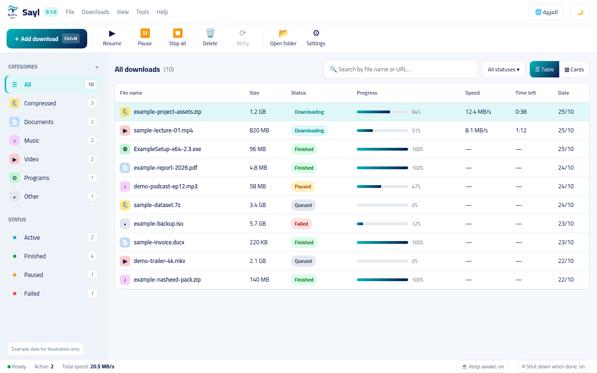

<div align="center">

[العربية](README.md) | [English](README.en.md)

<br>


# SAYL (سيل)

[](https://github.com/athar-studios/sayl/actions)
[](https://github.com/athar-studios/sayl/releases/latest)
[](LICENSE)
[](https://ko-fi.com/athar_studio)

**SAYL is a fast, lightweight Windows-first download manager built in Rust with a modern desktop UI, completely open source, and respecting your privacy with zero ads and zero telemetry.**

<br>



</div>

---

## Features

- **Multi-Connection Acceleration:** Splits files across concurrent connections to maximize bandwidth utilization.
- **Reliable Resumption:** Connection drops or unexpected reboots resume byte-for-byte using strong ETag verification without restarting from zero.
- **Bilingual Arabic & English:** Crafted with native Arabic RTL support and full English LTR experience, featuring clean typography and light/dark modes.
- **Drag & Drop:** Drop URLs directly from your browser into the window to start downloading immediately.
- **Automatic Categorization & Search:** Automatically sorts downloads into Video, Audio, Documents, Programs, and Compressed, paired with instantaneous real-time search.
- **Dedicated Progress Window:** Monitor per-chunk transfer rates, live connection status, speed, and ETA in an isolated progress view.
- **Auto-Shutdown & Sleep Inhibition:** Prevents Windows from entering sleep mode while downloads are in flight, with an optional 30-second countdown PC auto-shutdown.
- **Comprehensive CLI Tool:** A standalone `sayl.exe` binary offering complete queue control, crash recovery, and automation for PowerShell scripts.
- **Absolute Privacy:** No accounts, no ads, no tracking analytics (No Telemetry), and no intermediate proxy servers between your computer and your downloads.

---

## Download & Installation

Visit the **[GitHub Releases Page](https://github.com/athar-studios/sayl/releases/latest)** to download the latest build:

- **Windows Installer (64-bit):** `SAYL-Setup-x64-0.1.0.exe` (installs cleanly in user space without requiring administrator elevation).

> **Windows SmartScreen Notice:**  
> Because SAYL is an independent open-source project without a costly commercial EV code-signing certificate, Windows may show a blue warning saying 'Windows protected your PC / Unknown Publisher'.  
> To launch: click **'More info'** and then choose **'Run anyway'**. Sayl's source code is 100% open and auditable on GitHub.

---

## Quickstart

### Desktop Application (GUI)
1. Open SAYL from your Start Menu.
2. Click **'Add Download'** or press <kbd>Ctrl + N</kbd>.
3. Paste your URL and hit **'Start Download'**.

### Command-Line Interface (CLI)
Sayl is available directly from your terminal:

```powershell
# Add a download with 8 parallel connections
sayl add https://example.com/file.zip --connections 8

# List active and queued downloads
sayl list

# Pause or resume a task
sayl pause <id>
sayl start <id>

# Recover tasks interrupted by power loss
sayl recover
```

---

## Browser Extension

A Manifest V3 extension for Chromium-based browsers (Google Chrome, Microsoft Edge, Brave) is available in `extensions/browser/chromium`.

- Right-click any link and select **'Download with Sayl'**.
- Or enable automatic download interception.
- See setup instructions in the [Browser Integration Guide](https://sayl.site/docs#ext).

---

## Complete Documentation

Comprehensive command references, settings breakdown, server error behaviors, and architectural details are published on our official documentation site:

🌐 **[SAYL Official Documentation & User Guide](https://sayl.site/docs)**

---

## Building from Source

To compile Sayl locally on Windows:

```powershell
# Requirements: Rust (GNU toolchain) and Node.js 18+
rustup toolchain install stable-x86_64-pc-windows-gnu
$env:RUSTFLAGS = "-C linker=rust-lld"

# Check and run workspace tests
cargo check --workspace
cargo test --workspace

# Build the desktop application
cd apps/desktop
npm install
npm run tauri build
```

See **[docs/BUILD.md](docs/BUILD.md)** for detailed build instructions.

---

## Contributing

We welcome community contributions. Please read **[CONTRIBUTING.md](CONTRIBUTING.md)** and **[CODE_OF_CONDUCT.md](CODE_OF_CONDUCT.md)** before opening a Pull Request.

---

## Support Sayl

Sayl is and will always remain free and open source. If you find it helpful and wish to support our work and infrastructure, you can donate any amount via Ko-fi:

☕ **[Support us on Ko-fi](https://ko-fi.com/athar_studio)**

---

## License

Sayl is released under the **[Apache-2.0 License](LICENSE)**.
