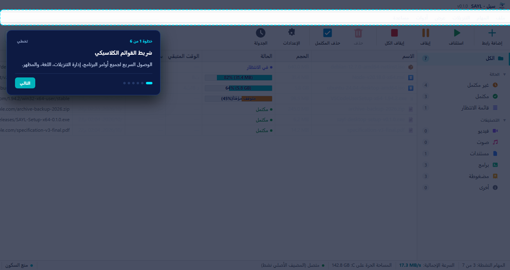

<div align="center">

[العربية](README.md) | [English](README.en.md)

<br>


# سيل (SAYL)

[](https://github.com/athar-studios/sayl/actions)
[](https://github.com/athar-studios/sayl/releases/latest)
[](LICENSE)
[](https://ko-fi.com/athar_studio)

**سيل مدير تنزيلات سريع وخفيف لنظام Windows، مبني بلغة Rust وواجهة سطح مكتب حديثة، مصدره متاح للجميع، ومجاني للاستخدام الشخصي وغير التجاري، ويحترم خصوصيتك بلا إعلانات ولا تتبّع.**

<br>



</div>

---

## مميزات سيل

- **تنزيل أسرع بالتقسيم:** يجزئ سيل الملف إلى عدة اتصالات متوازية مستقلة لاستغلال السعة الكاملة لاتصالك بالإنترنت.
- **استئناف موثوق:** انقطع الاتصال أو أغلقت الحاسوب؟ يكمل سيل التنزيل من آخر بايت مسجل دون إتلاف الملف أو بدء التنزيل من الصفر.
- **عربي وإنجليزي أصيل:** واجهة مبنية من اليمين إلى اليسار (RTL) مع خط مريح، ودعم كامل للإنجليزية والوضعين الفاتح والداكن.
- **اسحب وأفلت:** اسحب أي رابط تنزيل إلى نافذة البرنامج ليبدأ فحصه وتنزيله فورًا.
- **تصنيف وبحث لحظي:** فرز تلقائي لملفات الفيديو، الصوت، المستندات، البرامج، والمضغوطة، مع بحث سريع بالاسم أو الرابط.
- **نافذة تقدّم دقيقة:** تتبع تدفق كل اتصال مستقل في شريط مخصص، مع قياس السرعة اللحظية والوقت المتبقي.
- **إطفاء تلقائي ومنع السكون:** يمنع دخول النظام في وضع السكون أثناء التنزيل، مع خيار إطفاء الحاسوب بأمان بعد الانتهاء مع عداد تراجع مدته 30 ثانية.
- **سطر أوامر متكامل (CLI):** أداة `sayl.exe` المستقلة لإدارة الطوابور، استرداد المهام، وأتمتة العمليات عبر PowerShell.
- **خصوصية مطلقة:** لا حسابات مستخدمين، لا إعلانات، لا إحصاءات تتبّع (No Telemetry)، ولا خوادم وسيطة بينك وبين ملفاتك.

---

## التحميل والتثبيت

تفضل بزيارة **[صفحة الإصدارات على GitHub](https://github.com/athar-studios/sayl/releases/latest)** لتنزيل أحدث نسخة:

- **مثبت Windows (64 بت):** `SAYL-Setup-x64-0.1.0.exe` (تثبيت تلقائي دون الحاجة لصلاحيات المسؤول).

> **ملاحظة حول تنبيه Windows SmartScreen:**  
> نظرًا لأن سيل مشروع مجاني حديث ولا نملك بعد شهادة توقيع رقمي تجارية باهظة (EV Certificate)، قد يعرض نظام ويندوز نافذة زرقاء تفيد بأن «التطبيق غير معروف».  
> لتشغيل البرنامج: اضغط على **«مزيد من المعلومات» (More info)** ثم اختر **«التشغيل على أي حال» (Run anyway)**. كود سيل متاح بالكامل (source-available) ويمكنك مراجعته بنفسك للتأكد من أمانه.

---

## بداية سريعة

### واجهة البرنامج (GUI)
1. افتح سيل من قائمة ابدأ.
2. اضغط على زر **«إضافة تنزيل»** أو اختصار <kbd>Ctrl + N</kbd>.
3. الصق الرابط واضغط **«بدء التنزيل»**.

### سطر الأوامر (CLI)
سيل متاح كأمر مستقل في الطرفية:

```powershell
# إضافة رابط تنزيل بـ ٨ اتصالات متزامنة
sayl add https://example.com/file.zip --connections 8

# عرض قائمة التنزيلات والسرعة
sayl list

# إيقاف مهمة مؤقتًا أو استئنافها
sayl pause <id>
sayl start <id>

# استرداد المهام بعد انقطاع مفاجئ للكهرباء
sayl recover
```

---

## إضافة المتصفح

يتوفر ملحق متصفح لمتصفحات Chromium (Chrome, Edge, Brave) في مجلد `extensions/browser/chromium`.

- انقر بزر الفأرة الأيمن على أي رابط واختر **«التحميل باستخدام سيل»**.
- أو فعّل الالتقاط التلقائي للتنزيلات مباشرة.
- خطوات التفعيل مفصلة في [دليل المتصفح في التوثيق](https://sayl.site/docs#ext).

---

## التوثيق الشامل

الشرح التفصيلي لجميع أوامر الـ CLI، وإعدادات البرنامج خيارًا بخيار، وطرق التعامل مع أخطاء الخوادم تجده في صفحة التوثيق الرسمية:

🌐 **[دليل استخدام سيل الكامل على الموقع الرسمي](https://sayl.site/docs)**

---

## البناء من المصدر

لبناء سيل محليًا على نظام Windows:

```powershell
# المتطلبات: Rust (GNU toolchain) و Node.js 18+
rustup toolchain install stable-x86_64-pc-windows-gnu
$env:RUSTFLAGS = "-C linker=rust-lld"

# فحص واختبار كافة الحزم
cargo check --workspace
cargo test --workspace

# بناء واجهة سطح المكتب
cd apps/desktop
npm install
npm run tauri build
```

راجع **[docs/BUILD.md](docs/BUILD.md)** للحصول على التفاصيل الكاملة.

---

## المساهمة في المشروع

نرحب بمساهمات المطورين لتحسين الأداء أو إصلاح الأخطاء. يرجى قراءة **[CONTRIBUTING.md](CONTRIBUTING.md)** و**[CODE_OF_CONDUCT.md](CODE_OF_CONDUCT.md)** قبل إرسال طلب سحب (Pull Request).

---

## ادعم سيل

سيل مجاني للاستخدام الشخصي وسيبقى كذلك، وكوده متاح للجميع. إذا وجدت البرنامج مفيدًا وترغب في دعم استمراره وتطوير ميزاته القادمة، يمكنك دعمنا بأي مبلغ عبر منصة كوفي:

☕ **[ادعمنا على Ko-fi](https://ko-fi.com/athar_studio)**

---

## الرخصة

سيل منشور بموجب رخصة **[PolyForm Noncommercial 1.0.0](LICENSE)**.

- الكود متاح للجميع للاطلاع والتعديل.
- الاستخدام مجاني للأفراد ولأي غرض غير تجاري.
- الاستخدام التجاري يحتاج إذنًا مكتوبًا منا. للتواصل: contact@atharapp.download
