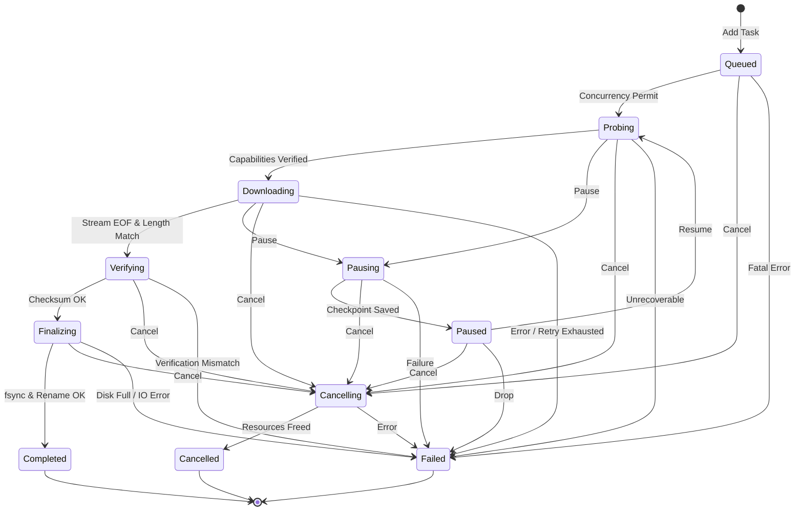
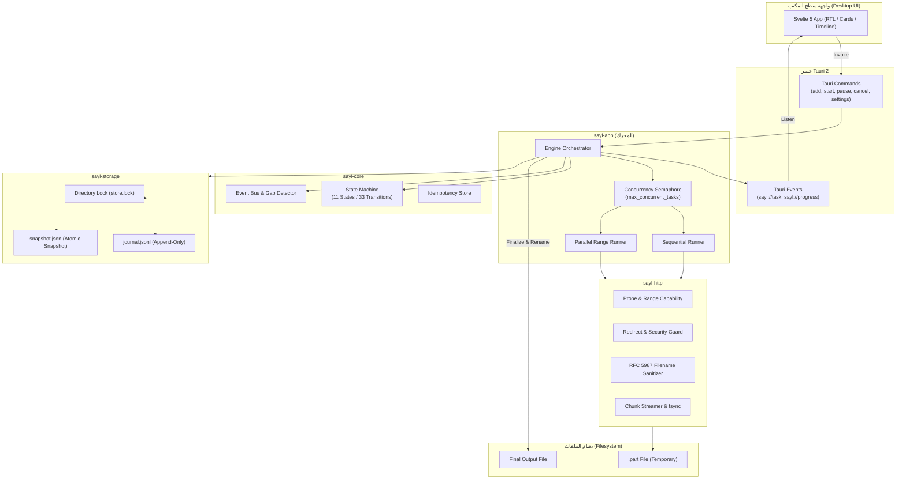

# معمارية نظام سيل (SAYL System Architecture)

تحدد هذه الوثيقة البنية المعمارية الشاملة لمدير التنزيل **سيل (SAYL)** — مدير تحميل مستقل لنظام Windows، مبني بلغة Rust مع واجهة مكتبية تفاعلية بـ Tauri 2 وSvelte 5.

---

## 1. هيكل الحزم ومسؤولياتها (The 9 Crates & Responsibilities)

تم تقسيم المشروع إلى حزم Rust معيارية مستقلة لضمان فصل الاهتمامات وسهولة الاختبار والصلابة:

```text
crates/
├── core/             # sayl-core: نماذج المجال، آلة الحالات، الأخطاء، الأحداث، مفاتيح عدم التكرار
├── storage/          # sayl-storage: مخزن العمليات الآمن المقاوم للأعطال (WAL + Atomic Snapshot)
├── http/             # sayl-http: عميل النقل، التحقق من النطاقات، سياسة إعادة التوجيه، أسماء الملفات
├── test-http/        # sayl-test-http: خادم محلي حتمي يحاكي 27 وضع فشل وحالات شبكة شاذة
├── app/              # sayl-app: خدمات التطبيق، محرك الجدولة، تنسيق التنزيل التسلسلي والمتوازي
├── cli/              # sayl-cli: [مخطط] واجهة سطر الأوامر المستقلة
├── media/            # sayl-media: [مخطط] محولات yt-dlp و FFmpeg لمعالجة وتجزئة الوسائط
├── torrent/          # sayl-torrent: [مخطط] محول librqbit لبروتوكول التورنت وتبادل الند للند
└── plugin-host/      # sayl-plugin-host: [مخطط] بيئة تشغيل WASM المعزولة وموزع الأذونات
```

### تفصيل مسؤوليات الحزم (Crate Responsibilities)

1. **`sayl-core` (Core Domain Engine):**  
   - تعريف آلة الحالات الإحدى عشرة `DownloadState` ودوال الانتقال المحمية `transition`.
   - هيكل الأخطاء المصنف `CoreError` وتحديد قابلية الإعادة `is_retryable()`.
   - ناقل الأحداث الداخلي ذو السعة المحدودة ونظام كشف فجوات التسلسل `SequenceGapDetector`.
   - معرّفات المهام الزمنية `TaskId` القائمة على `UUID v7` ومخزن مفاتيح منع التكرار `IdempotencyStore`.
   - حزمة نقية لا تحتوي على عمليات I/O مباشرة أو مكتبات تشغيل خارجية ثقيلة.

2. **`sayl-storage` (Crash-Safe Persistence):**  
   - توفير مخزن مهام محلي متين بدون الاعتماد على C-compilers أو ملفات SQLite خارجية.
   - كتابة السجلات الدورية عبر سجل العمليات التراكمي `journal.jsonl` (Append-Only JSON-Lines).
   - دمج السجلات الذري عبر اللقطات `snapshot.json` المحمية بـ `fsync` وعملية التسمية الذرية.
   - قفل المجلد الحصري `store.lock` على مستوى نظام التشغيل (Windows `share_mode(0)`).
   - استعادة المهام ونقاط المتابعة (`Checkpoint`) بعد التعطل المفاجئ مع تسامح كامل مع السطور المبتورة.

3. **`sayl-http` (HTTP Transport & Range Client):**  
   - عميل شبكي مبني على `reqwest` بدون متطلبات C/C++ إضافية.
   - فحص الموارد النشط `probe` عبر `HEAD` ثم الرجوع التلقائي إلى `GET Range: bytes=0-0`.
   - التحقق الصارم من دعم النطاقات `RangeSupport` (Supported, Ignored, Unsupported, Unknown).
   - تتبع إعادة التوجيه الآمن `RedirectTracker` (سقف 5 قفزات، تجريد بيانات الاعتماد عبر النطاقات، حظر البروتوكولات الخطرة).
   - استخراج وتطهير أسماء الملفات `derive_filename` وفق RFC 5987/6266 ومنع اجتياز المسارات وأسماء أجهزة Windows المحجوزة.
   - تدفق البيانات للقرص مع تفريغ دوري وتحقق إلزامي من مطابقة الطول الكلي قبل اعتماد النجاح.

4. **`sayl-test-http` (Deterministic Fixture Server):**  
   - خادم HTTP/1.1 محلي مستقل يربط حصرياً على واجهة `127.0.0.1:0`.
   - محاكاة كاملة لـ 27 سيناريو فشل وبروتوكول شاذ (Master-Plan §8).
   - توليد بايتات حتمية واختبار تطابق الأنماط عبر `BodyGenerator`.
   - تسجيل والتحقق من تسلسل الطلبات الواردة `verify_requests`.

5. **`sayl-app` (Orchestration Engine):**  
   - إدارة المحرك المركزي `Engine`، وتنسيق المهام وحصص التزامن عبر `tokio::sync::Semaphore`.
   - التنسيق بين التنزيل التسلسلي `sequential` والتنزيل المتوازي المقسم `parallel`.
   - إدارة رموز الإلغاء `CancellationToken` والإيقاف المؤقت، وتحديث نقاط المتابعة في المخزن.
   - معالجة الاسترداد التلقائي للمهام غير المكتملة عند تشغيل التطبيق عبر `recover()`.

6. **`sayl-cli` / `sayl-media` / `sayl-torrent` / `sayl-plugin-host`:**  
   - حزم هيكلية مخطط لها ومفصولة في التصميم المستقبلي (انظر خريطة الطريق).

---

## 2. آلة حالات دورة حياة المهمة (Task Lifecycle State Machine)

تتألف دورة حياة مهمة التنزيل من **11 حالة صريحة** تحكمها دالة الانتقال المحمية `transition(from, to)`:

### الحالات الإحدى عشرة (The 11 Discrete States)
1. `Queued`: المهمة في طابور الانتظار.
2. `Probing`: استكشاف الرابط وفحص قدرات الخادم.
3. `Downloading`: النقل النشط للبيانات من الخادم للقرص.
4. `Verifying`: التحقق من الحجم وسلامة البايتات وبصمة الملف.
5. `Finalizing`: مزامنة القرص عبر `fsync` وتسمية الملف النهائي.
6. `Completed`: حالة نهائية؛ اكتمل التنزيل بنجاح.
7. `Pausing`: جلب العمال لنقطة توقف مستقرة وحفظ الإحداثيات.
8. `Paused`: حالة خاملة للمهمة مع حفظ تقدم جزئي دائم.
9. `Cancelling`: قطع الاتصالات وسحب الحصص والنطاقات.
10. `Cancelled`: حالة نهائية؛ أُلغيت المهمة نهائياً.
11. `Failed`: حالة نهائية؛ تعذر التنزيل أو استنفدت المحاولات.

### مصفوفة الانتقالات وقاعدة الانتقال الذاتي الحيادي (Transitions & Idempotence)
- **الحالات النهائية (Terminal States):**  
  `Completed` و `Cancelled` و `Failed`. لا يُسمح بأي انتقال يخرج منها، ولا يُسمح لها بالانتقال إلى نفسها.
- **الانتقالات الصالحة بين الحالات المختلفة (25 انتقالاً):**  
  - `Queued` $\rightarrow$ `[Probing, Cancelling, Failed]` (3)
  - `Probing` $\rightarrow$ `[Downloading, Pausing, Cancelling, Failed]` (4)
  - `Downloading` $\rightarrow$ `[Verifying, Pausing, Cancelling, Failed]` (4)
  - `Verifying` $\rightarrow$ `[Finalizing, Cancelling, Failed]` (3)
  - `Finalizing` $\rightarrow$ `[Completed, Cancelling, Failed]` (3)
  - `Pausing` $\rightarrow$ `[Paused, Cancelling, Failed]` (3)
  - `Paused` $\rightarrow$ `[Probing, Cancelling, Failed]` (3)
  - `Cancelling` $\rightarrow$ `[Cancelled, Failed]` (2)
- **قاعدة الانتقال الذاتي الحيادي غير النهائي (Idempotent Non-Terminal Self-Transitions):**  
  أي حالة غير نهائية يُسمح لها بالانتقال إلى نفسها دون أي تغيير في الحالة (`from == to && !from.is_terminal()`). يشمل ذلك **8 حالات**:  
  `Queued`, `Probing`, `Downloading`, `Verifying`, `Finalizing`, `Pausing`, `Paused`, `Cancelling`.
- **الإجمالي الحسابي للمصفوفة (33 صالح / 88 غير صالح من أصل 121):**  
  عدد الحالات الكلي هو 11، وبالتالي فإن شبكة التباديل الممكنة هي $11 \times 11 = 121$ انتقالاً.  
  الانتقالات المسموحة: $25 \text{ (بين حالات مختلفة)} + 8 \text{ (انتقالات ذاتية)} = \mathbf{33}$ انتقالاً صالحاً.  
  الانتقالات المرفوضة: $121 - 33 = \mathbf{88}$ انتقالاً غير صالح ومحمي برمجياً برفض فوري `StateTransitionError`.

### مخطط آلة الحالات (Mermaid State Diagram)



---

## 3. تدفق الأحداث وكشف الفجوات (Event Flow & Sequence Gap Detection)

تعتمد البنية على ناقل أحداث أحادي الاتجاه غير حاجب لتوثيق كل تغير في المحرك:
- **هيكل الحدث (`Event`):**
  - `id`: رقم تسلسلي تصاعدي صارم (`u64`) لكل مهمة.
  - `task_id`: معرّف المهمة الفريد `TaskId` (`Uuid v7`).
  - `timestamp`: طابع زمني عالمي `DateTime<Utc>`.
  - `kind`: صنف الحدث `EventKind` (واحد من 8 أنواع):  
    `StateChanged`, `Progress`, `Checkpoint`, `Split`, `Retry`, `Error`, `Cancelled`, `Completed`.
  - `payload`: البيانات التفصيلية المرتبطة بالحدث `EventPayload`.
- **كاشف فجوات التسلسل (`SequenceGapDetector`):**  
  عند استقبال الأحداث عبر الواجهة، يتأكد الكاشف من أن `event.id == expected_id`. إذا حدث انقطاع أو تأخر وأسفر عن فجوة في الترقيم (`received > expected`)، يتم إشعار الواجهة بوجود فجوة، مما يدفعها فوراً لطلب مزامنة لقطة كاملة (`Snapshot Sync`) من المخزن الدائم بدلاً من البناء على حالة جزئية مفقودة.

---

## 4. تصميم المخزن الآمن من التعطل (Crash-Safe Storage Design)

تم تصميم `sayl-storage` ليعمل بنمط السجل التراكمي المقترن باللقطات الذرية (WAL + Atomic Compaction) دون الحاجة لمحرك SQLite خارجي:

```text
[ عمليات الإدخال / التعديل ]
            │
            ▼
┌───────────────────────┐
│     journal.jsonl     │  (Append-Only JSON-Lines، تفريغ فوري لكل تعديل)
└───────────────────────┘
            │
            ▼ (عملية الدمج والضغط compact)
┌───────────────────────┐
│  snapshot.json.tmp    │ ───► sync_all (fsync) ───► Atomic Rename ───► snapshot.json
└───────────────────────┘                                                     │
                                                                              ▼
                                                    تصفير journal.jsonl إلى حجم 0 بايت
```

### ضمانات الأمان عند انقطاع الطاقة أو تعطل النظام
1. **اللقطات الذرية (Atomic Snapshots):** تُكتب اللقطة دائماً إلى ملف مؤقت عشوائي، ثم يُنفذ عليها استدعاء `sync_all` لضمان استقرارها المادي على وسائط التخزين، ثم تُنقل ذرياً فوق `snapshot.json`.
2. **التسامح مع الذيول المبتورة (Truncated Tail Tolerance):** في حال انقطاع الكهرباء أثناء كتابة سطر في `journal.jsonl`، يتجاهل قارئ المخزن السطر الأخير غير المكتمل، ويقتطع الملف إلى آخر بايت سليم موثق، بينما تُرفض أي بيانات فاسدة في منتصف السجل.
3. **قفل الكاتب الواحد (Single-Writer Lock):** يُنشأ ملف `store.lock` بفتح حصري على مستوى النواة في Windows عبر `share_mode(0)`، مقترناً بسجل داخل العملية يمنع تشغيل أكثر من معالج مخزن على نفس المسار في نفس اللحظة.

---

## 5. طبقة النقل الشبكي (The HTTP Transport Layer)

تسير عملية فحص وجلب الملفات عبر المراحل المنضبطة التالية:

1. **الاستكشاف (Probe):**  
   إرسال طلب `HEAD` للرابط. إذا رفض الخادم الطلب برمز `405` أو `501`، يتم التحول تلقائياً إلى طلب `GET Range: bytes=0-0` لاستخراج المعلومات الأساسية.
2. **التحقق من النطاقات (Range Verification):**  
   - فحص استجابة الخادم: هل أعاد رمز `206 Partial Content` مع رأس `Content-Range` صحيح؟
   - تصنيف الخادم:  
     - `Supported`: يدعم النطاقات والاستئناف والتوازي.
     - `Ignored`: أعاد رمز `200` بدلاً من `206` متجاهلاً النطاق؛ يُحول تلقائياً للتنزيل التسلسلي دون استئناف جزئي.
     - `Unsupported`: يرفض النطاقات صراحة أو يعيد رؤوساً مشوهة.
     - `Unknown`: لم تتوفر معلومات كافية.
3. **سياسة إعادة التوجيه الصارمة (Redirect Policy):**  
   - سقف أقصى 5 قفزات لمنع الحلقات اللانهائية.
   - تجريد رؤوس الأمان الحساسة (`Authorization`, `Cookie`, `Proxy-Authorization`) فور تغير النطاق الأصلي (Scheme / Host / Port).
   - حظر أي بروتوكول خارج `http` و `https` (مثل `file:` أو `data:`).
4. **تطهير أسماء الملفات (Safe Filenames):**  
   - استخراج الاسم من `Content-Disposition` (RFC 5987 / RFC 6266) مع دعم نصوص الترميز العالمية UTF-8.
   - إزالة محاولات اجتياز المجلدات (`..` و `/` و `\`).
   - استبدال الرموز المحجوزة في Windows (`<>:"/\|?*`) والرموز غير المرئية بـ `_`.
   - تحييد أسماء أجهزة Windows المحجوزة (`CON`, `PRN`, `AUX`, `NUL`, `COM1-9`, `LPT1-9`) بإضافة بادئة `_CON.ext`.
   - توحيد الحروف وفق معيار Unicode NFC لضمان سلامة الأسماء العربية، وسقف أقصى 255 حرفاً.
5. **التدفق للقرص (Streaming & fsync):**  
   - الكتابة عبر مخازن مؤقتة بحجم 64 كيلوبايت.
   - تحقق إلزامي من مطابقة البايتات المكتوبة للحجم الإجمالي المعلن لمنع إعلان الاكتمال الزائف (False Complete).
   - تنفيذ `sync_all` على ملف `.part` قبل الانتقال لمرحلة `Finalizing`.

---

## 6. قواعد الاستئناف الآمنة والتحقق (Validator-Safe Resume Rules)

الاستئناف الآمن يتطلب دليلاً قطعياً على أن الملف البعيد لم يطرأ عليه أي تغيير أثناء فترة التوقف:

- **الوسم القوي مقابل الوسم الضعيف (Strong vs Weak ETag):**  
  وفق معيار HTTP Semantics (RFC 9110 / RFC 7232)، يبدأ الوسم الضعيف بالسابقة `W/"..."`.
- **القاعدة الحتمية:** **الوسم الضعيف (Weak ETag) لا يُستخدم مطلقاً لترخيص رأس `If-Range`!**  
  الوسوم الضعيفة تفيد في التخزين المؤقت العام ولكنها لا تضمن تطابق البايتات الدقيقة. في سيل، إذا كان الخادم يقدم وسم ETag ضعيفاً فقط، أو لا يقدم أي وسوم تحقق، يرفض المحرك الاستئناف المباشر ويبدأ التنزيل من الصفر لحماية سلامة الملف.
- **الوسم القوي (Strong ETag):** يُستخدم لطلب الاستئناف عبر `If-Range: "strong-etag"`، فإذا تطابق يعود الخادم بـ `206` ويستأنف التنزيل، وإذا تغير يعيد `200` بالملف كاملاً فيبدأ المحرك من جديد بأمان.
- **تاريخ التعديل (`Last-Modified`):** يُعتمد عليه في الاستئناف فقط عند استيفاء شروط الدقة الزمنية المعتمدة وغياب تعارض الوسوم.

---

## 7. مسار التنزيل المتوازي مع الحصص (Bounded Parallel Path & Leases)

عند توفر خادم يدعم التجزئة بحجم معروف، يمكن للمحرك تفعيل التنزيل المتوازي:

1. **التقسيم إلى نطاقات منفصلة:**  
   تُقسم المساحة الكلية إلى نطاقات نصف مفتوحة `[start, end_exclusive)`، بدون أي تداخل أو فجوات.
2. **عقود الحصص (Segment Leases):**  
   - يمتلك كل عامل اتصال حصة لنطاق محدد برقم جيل زمني `lease_generation`.
   - يكتب العامل في الموضع الدقيق داخل ملف `.part`.
   - يملك منسق الحصص سلطة سحب الحصة وإلغائها عند بطء العامل أو تغير المورد.
3. **التقسيم الديناميكي (Dynamic Splitting):**  
   عند توفر عامل خامل، يتم اختيار أكبر نطاق متبقٍ مؤهل، وإيقاف عمل صاحبه لحظياً (Quiesce)، وتأكيد حاجز الكتابة، ثم تقسيم الذيل غير المنقول عند نقطة المنتصف، وتعيين جيل حصة جديد للعمال.

---

## 8. حدود التواصل بين المحرك والواجهة (Engine / UI Boundary)

تتصل واجهة سطح المكتب (Svelte) مع محرك Rust عبر طبقة Tauri 2 حصراً:

### أوامر Tauri المتاحة (Tauri Commands)
| الأمر | الوصف الفني |
|---|---|
| `add_task(url)` | فحص الرابط وإدراجه كمعرّف `TaskId` جديد في حالة `Queued` وبدء تنفيذه. |
| `start_task(id)` | بدء أو استئناف مهمة متوقفة في خلفية التطبيق. |
| `pause_task(id)` | طلب إيقاف مؤقت، حفظ النقطة المرجعية في المخزن، ونقل الحالة إلى `Paused`. |
| `cancel_task(id)` | إلغاء التنزيل وتحرير موارده وحصصه. |
| `list_tasks()` | استرجاع كافة المهام مع إحصائيات السرعة والوقت المتبقي الحيّة. |
| `get_settings()` | قراءة إعدادات المستخدم من الذاكرة والقرص. |
| `set_settings(settings)` | التحقق من صحة الإعدادات وتحديثها وحفظها في `settings.json`. |
| `open_download_folder()` | تشغيل مستكشف ملفات Windows لفتح مجلد التنزيل النشط. |
| `reveal_task(id)` | فتح مستكشف الملفات مع تحديد ملف المهمة المكتملة بعينها. |

### أحداث Tauri المرسلة للواجهة (Tauri Events)
1. **`sayl://progress`:**  
   بث دوري لإحصائيات التقدم المباشر (`id`, `written`, `total`, `speed_bps`) لتحديث أشرطة التقدم دون إرهاق الواجهة.
2. **`sayl://task`:**  
   بث كامل لأحداث المجال الصادرة عن المحرك (`EventKind`: تغير الحالة، اكتمال التنزيل، الأخطاء، الإلغاء) لضمان اتساق الواجهة الرسومية مع النواة.

---

## 9. المخطط المعماري العام وتدفق البيانات (Component & Data Flow Diagram)


