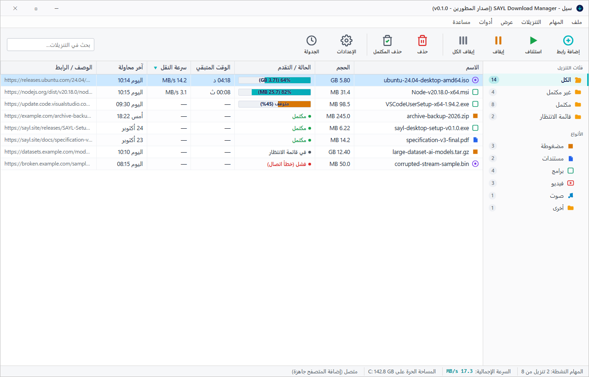
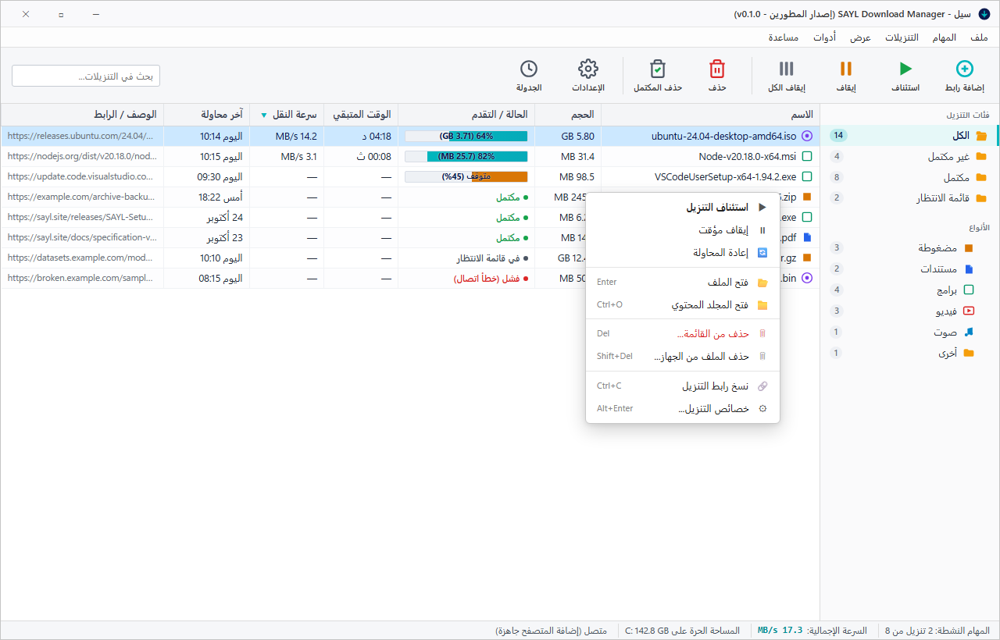
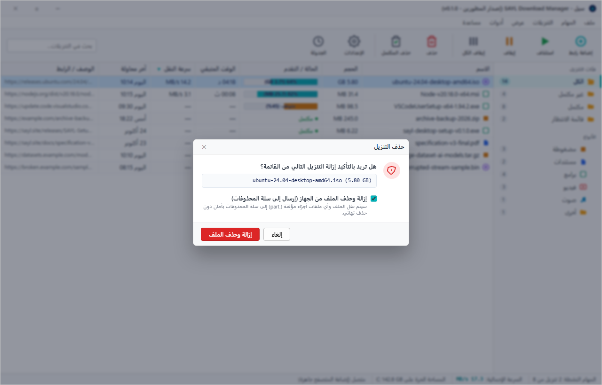
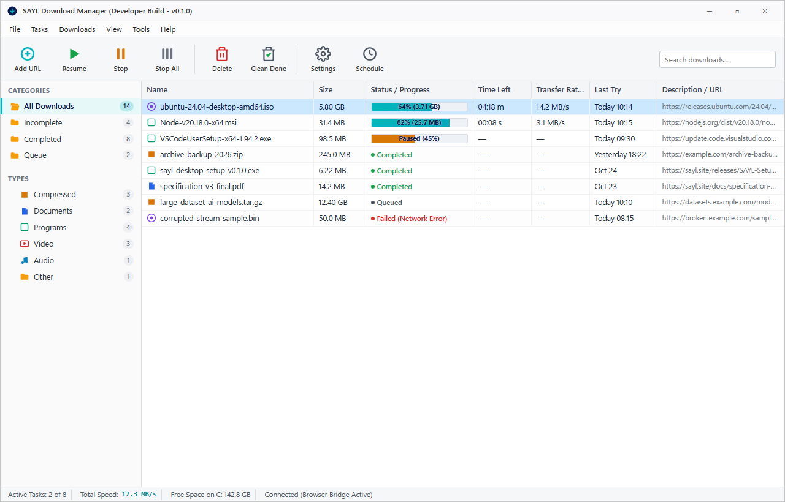

# تصميم واجهة سيل الأصلية (Native Windows Desktop UI Specification)

وثيقة مواصفات وتصاميم واجهة المستخدم الأصلية المقترحة لبرنامج **سيل (SAYL)** لتبدو وتعمل كتطبيق ويندوز أصلي متقدم وعالي الأداء (على طراز IDM و FDM الكلاسيكي الاحترافي)، مع الحفاظ على ألوان هوية سيل (الكحلي `#0b1a4e` والفيروزي `#00b6bd`) كلسمات مميزة فقط (Accents).

---

## 1. نماذج التصميم (Screenshots & Mockups)

تم توليد هذه النماذج البصرية بدقة فائقة وحفظها في هذا المجلد:

### أ) النافذة الرئيسية (بالعربية - RTL الافتراضي)

- **المسار:** [`docs/ui-mockups/native/main-window.png`](main-window.png)
- **الوصف:**
  - شريط القوائم الكلاسيكي: `ملف`، `المهام`، `التنزيلات`، `عرض`، `أدوات`، `مساعدة`.
  - شريط أدوات بأزرار وأيقونات كبيرة 32x32 وتسميات أسفلها: `إضافة رابط`، `استئناف`، `إيقاف`، `إيقاف الكل`، `حذف`، `حذف المكتمل`، `الإعدادات`، `الجدولة`.
  - شجرة التصنيفات والحالات على اليمين/اليسار بنمط IDM مع عدادات دقيقة لكل فئة.
  - جدول بيانات كثيف وأصلي (Dense Data Grid) مع أعمدة قابلة لتغيير الحجم والترتيب، وارتفاع مدمج للصفوف (26px) وخط النظام `Segoe UI` بحجم 13px، مع شريط تقدم مدمج داخل خلية الحالة.
  - شريط حالة سفلي مدمج يقسم السرعة الإجمالية، المهام النشطة، مساحة القرص وحالة الجسر.

---

### ب) قائمة السياق عند النقر بالزر الأيمن (Context Menu)

- **المسار:** [`docs/ui-mockups/native/context-menu.png`](context-menu.png)
- **الوصف:**
  - قائمة ويندوز أصلية وسريعة تُستدعى عبر Tauri Menu API.
  - تحتوي على الأوامر الشائعة: فتح الملف (`Enter`)، فتح مجلد الحفظ (`Ctrl+O`)، استئناف، إيقاف، حذف من القائمة (`Del`)، حذف مع الملف (`Shift+Del`)، نسخ الرابط (`Ctrl+C`)، والخصائص (`Alt+Enter`).

---

### ج) حوار تأكيد الحذف (IDM-style Native Delete Dialog)

- **المسار:** [`docs/ui-mockups/native/delete-dialog.png`](delete-dialog.png)
- **الوصف:**
  - حوار تأكيد يظهر بنمط نظام ويندوز عند طلب حذف تنزيل أو عدة تنزيلات.
  - مربع الاختيار: `إزالة وحذف الملف من الجهاز (إرسال إلى سلة المحذوفات)` (افتراضياً: غير محدد).
  - الزر الرئيسي يتغير ديناميكياً:
    - عند عدم التحديد: **«إزالة من القائمة فقط»**
    - عند التحديد: **«إزالة وحذف الملف»**
  - زر الإلغاء: **«إلغاء»**.

---

### د) النافذة الرئيسية بالإنجليزية (English LTR Toggle)

- **المسار:** [`docs/ui-mockups/native/main-window-en.png`](main-window-en.png)
- **الوصف:**
  - دعم كامل للتحويل إلى الإنجليزية (LTR) مع قلب مواضع شجرة الفئات والقوائم واتجاه الجدول تلقائياً.

---

## 2. المقارنة بين الواجهة الحالية وواجهة التطبيق المكتبي المقترحة

| العنصر | الواجهة السابقة (Web-like) | الواجهة المقترحة (Native Desktop) |
|---|---|---|
| **الهيكل العام** | بطاقات عائمة بظلال وزوايا دائرية كبيرة (14px) وحركة ارتدادية | نافذة ويندوز كلاسيكية كثيفة بحدود واضحة 1px وشبكة بيانات منظمة |
| **شريط الأدوات** | شريط أزرار ويب متباعدة ومائلة للتصميم المسطح | شريط أدوات مكتبي بأيقونات 28-32px وتسميات نصية تحتها (IDM Toolbar) |
| **القوائم** | قائمة منبثقة غير قياسية | شريط قوائم ويندوز كلاسيكي كامل (`ملف`، `المهام`، `التنزيلات`، `عرض`، `أدوات`، `مساعدة`) |
| **عرض المهام** | عرض البطاقات الافتراضي الكبير بارتفاع يتجاوز 110px لكل مهمة | شبكة بيانات كثيفة (Data Grid) بارتفاع 24-28px للصف، مع إبقاء عرض البطاقات كخيار في قائمة `عرض` |
| **الخطوط والأحجام** | خطوط ويب افتراضية وأحجام خطوط كبيرة (14-16px) | خط النظام الأصلي (`Segoe UI` / `Segoe UI Variable` مع بدائل عربية ملائمة) بحجم 13px مريح وعالي الكثافة |
| **الألوان** | طغيان اللون الفيروزي على خلفيات وزوايا البطاقات | الاعتماد على ألوان النظام الطبيعية، وحصر الكحلي `#0b1a4e` والفيروزي `#00b6bd` في لمسات التمييز وشريط التقدم وشعار التطبيق |
| **التفاعل مع الفأرة والنصوص** | تحديد النصوص الافتراضي في المتصفح وظهور قائمة سياق الويب | تعطيل تحديد النصوص وقوائم سياق المتصفح، مع النقر المزدوج لفتح الملف، والتحديد بزر الفأرة مع `Ctrl`/`Shift` |
| **سلة المحذوفات** | حذف وهمي يقتصر على إيقاف المهمة | حذف حقيقي مع نقل آمن للملفات وملفات الأجزاء `.part` إلى سلة محذوفات ويندوز عبر Shell API |

---

## 3. خطة تنفيذ الجزء الثاني (بعد موافقة المالك)

1. **شريط القوائم الأصلي (Native Menu Bar)**:
   - بناء شريط القوائم العلوي الكلاسيكي أو ربطه مع واجهة Tauri Native Menu.
2. **شريط الأدوات المكتبي (Desktop Toolbar)**:
   - استبدال أزرار الويب الحالية بشريط أدوات مكتبي يحتوي الأيقونات والتسميات المحددة.
3. **شجرة الفئات (Category Tree)**:
   - تطوير مكون شجرة الفئات المكتبي على اليسار/اليمين بدلاً من الشريط الجانبي البسيط الحالي.
4. **جدول البيانات الكثيف (Dense Virtual Grid)**:
   - جعل نمط الجدول هو الافتراضي مع الأعمدة المطلوبة بالترتيب الدقيق: الاسم، الحجم، الحالة، الوقت المتبقي، سرعة النقل، آخر محاولة، الوصف.
5. **إلغاء خصائص الويب الدخيلة**:
   - إزالة الظلال الكبيرة والزوايا الدائرية الزائدة والتحريكات البطيئة وارتداد التمرير، ومنع تحديد النصوص وقائمة المتصفح.
6. **تحديث الجولة التعريفية (Tour)**:
   - مواءمة خطوات الجولة لتشير إلى المكونات المكتبية الجديدة بدقة.
